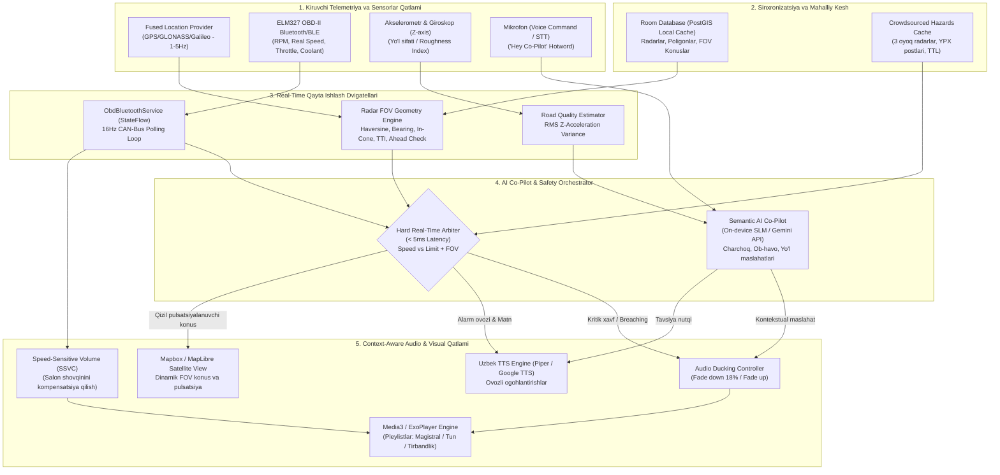

# AIntiRADAR - Professional Uzbekistan Smart Anti-Radar & AI Co-Pilot Architecture

## 1. Tizim Arxitekturasi va Ma'lumotlar Oqimi (Data Pipelines)

---

## 2. Asosiy Quvurlar (Pipelines) Ishlash Mexanizmi

1. **Geolocation & Radar Vision Pipeline:**
   - Har bir GPS kadrida ($1-5\text{ Hz}$) transport vositasining koordinatasi va harakat yo'nalishi (`heading`) olinadi.
   - Avtomobilning $2000\text{ m}$ radiusidagi barcha faol radarlar keshdan olinadi.
   - Har bir radar uchun `isPointInsideFovCone` va `isVehicleHeadingTowardsRadar` funksiyalari orqali avtomobil radarning ko'rish konusiga kirayotganligi yoki ichidaligi aniqlanadi.
   - Agar $V_{car} > V_{limit} + 5\text{ km/h}$ bo'lsa, xavf darajasi zudlik bilan `CRITICAL_BREACH` yoki `WARNING_APPROACHING` ga o'zgaradi.

2. **OBD-II CAN-Bus Telemetriya Pipeline:**
   - `ObdBluetoothService` ELM327 orqali $16\text{ Hz}$ chastotada dvigatel aylanishlari (RPM), spidometrning real tezligi, gaz pedali holatini o'qiydi.
   - GPS drayveri tunnel, ko'prik osti yoki daraxtzorlarda yo'qolganda ham OBD-II tezligi orqali hisoblashlar to'xtovsiz davom etadi.

3. **Audio Ducking va SSVC Pipeline:**
   - Radar yoki AI Co-Pilot ogohlantirishi boshlanganda musiqa ovozi $300\text{ ms}$ ichida $18\%$ ga pasaytiriladi (`setDuckingEnabled(true)`).
   - Ovozli xabar tugashi bilan musiqa avvalgi darajasiga silliq qaytariladi.
   - Tezlik $0\text{ km/soat}$ dan $120\text{ km/soat}$ gacha ko'tarilganda salon ichidagi shovqinni yengish uchun umumiy musiqa ovozi dinamik ravishda $25\%$ gacha oshiriladi.
